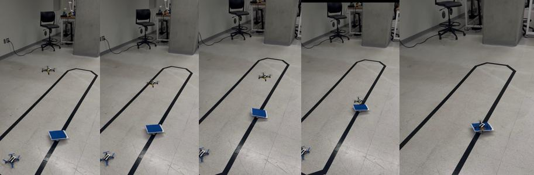

# Vision-Based Drone Landing on a Moving Robot

A Parrot Mambo quadcopter that finds a blue landing pad on a moving line-following robot with its downward camera, stays centered over it, and lands before the robot reaches the end of the line. Built in MATLAB/Simulink and deployed to the drone with code generation.



## How it works

**Vision.** The camera frame (YUV) is converted to RGB. `createMask.m` thresholds for the blue pad (tuned in MATLAB's Color Thresholder), and the mask is split into 5 regions (top, mid, bottom, left, right) with a pixel count for each.

**Position control.** The drone tracks position references, and the Simulink controller corrects them from the pixel counts:

```
X_ref = X + Kx · (n_right − n_left)
Y_ref = Y + Ky · (n_bottom − n_top)
Z_ref = Z − ΔZ          (during descent)
```

**Landing timing.** Descent starts when the time the robot has left to reach the end of the line drops to about the drone's descent time. A failsafe lands automatically when flight time remaining drops below 5 s.

**Results.** On hardware the drone landed on the moving robot before the end of a straight line. It also worked on a curved track after retuning the lateral gains.

## Hexacopter lab

`hexacopter/hexacopter_position_control.slx` is a hexacopter built from scratch in Simulink:
- 6-DOF rigid-body dynamics with per-rotor thrust and torque
- Motor mixing matrix (force/moment → 6 rotor commands)
- Cascaded control: PID position loops (X/Y/Z) → PD attitude loops (roll/pitch/yaw)
- 3D UAV visualization

## Repo layout

```
parrot_mambo_landing/       Simulink project (open ParrotMinidroneKeyboardControl.prj)
  controller/flightControlSystem.slx   code-generation target
  createMask.m                         landing-pad color mask
hexacopter/                 hexacopter dynamics + control model
media/demo.mp4              hardware run
docs/Project_Report.pdf     full write-up
```

Requires MATLAB/Simulink (R2025b) with Aerospace Blockset and the Simulink Support Package for Parrot Minidrones. The hexacopter model also uses the UAV Toolbox.

RAS 546 Robotic Systems II, Arizona State University, Spring 2026.
